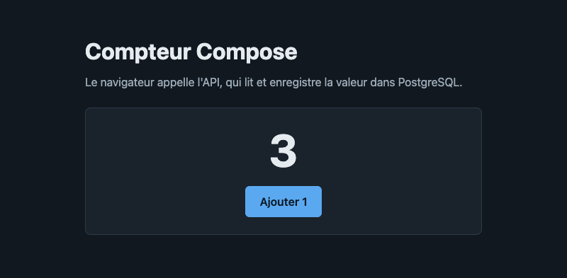

# TP Compose : front, API et base de données

Application composée de trois services décrits dans `compose.yaml` : une page web affiche un compteur, une API le lit et l'incrémente, et une base PostgreSQL conserve sa valeur.

## Architecture

```text
Navigateur ── localhost:9091 ──> front (Nginx, port interne 8080)
                                   │  /api/ -> http://api:3000
                                   ▼
                                 api (Node.js, port interne 3000)
                                   │  db:5432
                                   ▼
                                 db (PostgreSQL) ── volume db-data
```

| Service | Image | Rôle | Publié sur l'hôte |
|---|---|---|---|
| `front` | Construite depuis `front/` | Sert la page et transmet `/api/` à l'API | Oui, port 9091 |
| `api` | Construite depuis `api/` | Expose les routes et interroge la base | Non |
| `db` | `postgres:17-alpine` | Conserve la valeur du compteur | Non |

- **Communication entre services :** le DNS interne de Compose résout les noms `api` et `db`, avec les ports internes.
- **Accès depuis le navigateur :** il ne passe que par le port publié du front et n'atteint jamais la base directement.
- **Ordre de démarrage :** les healthchecks et `depends_on` attendent que la base, puis l'API, soient réellement prêtes.
- **Persistance :** le volume nommé `db-data` conserve la valeur après un `docker compose down`.

## Lancement

Prérequis : Docker et le plugin Docker Compose.

```bash
docker compose up -d --build
```

L'application est ensuite disponible sur <http://localhost:9091>.

```bash
docker compose ps             # état des services
docker compose logs -f api    # journaux de l'API
docker compose down           # arrête tout et conserve les données
docker compose down -v        # arrête tout et SUPPRIME les données
```

## Paramètres

Ces valeurs sont **factices** et ne servent qu'en local. Elles s'appliquent par défaut, donc aucune configuration n'est nécessaire pour lancer le projet.

| Variable | Valeur par défaut | Rôle |
|---|---|---|
| `POSTGRES_DB` | `tp_compose` | Nom de la base |
| `POSTGRES_USER` | `tp_user` | Utilisateur de la base |
| `POSTGRES_PASSWORD` | `mot_de_passe_factice` | Mot de passe de la base |

Pour les remplacer, créez un fichier `.env` à la racine, à côté de `compose.yaml`. Il est ignoré par Git. Si la base existe déjà, lancez `docker compose down -v` avant de changer ces valeurs, car PostgreSQL ne les lit qu'à sa première initialisation.

## Routes de l'API

| Route | Rôle |
|---|---|
| `GET /api/health` | Vérifie l'API et sa connexion à la base |
| `GET /api/compteur` | Lit la valeur |
| `POST /api/compteur` | Ajoute 1 à la valeur |

## Tests

```bash
# Le navigateur atteint l'API à travers le port publié
curl http://localhost:9091/api/health

# L'API écrit dans la base
curl -X POST http://localhost:9091/api/compteur

# La valeur est bien dans PostgreSQL
docker compose exec db psql -U tp_user -d tp_compose -c "SELECT * FROM compteur;"

# Le front joint l'API par son nom de service
docker compose exec front wget -qO- http://api:3000/api/health

# La valeur survit à un arrêt complet
docker compose down
docker compose up -d
curl http://localhost:9091/api/compteur
```

Dans le navigateur, le bouton « Ajouter 1 » augmente le compteur, et la valeur reste affichée après un rechargement.

## Preuves de fonctionnement

| Fichier | Contenu |
|---|---|
| [`preuves/01-demarrage.txt`](preuves/01-demarrage.txt) | Sortie de `docker compose up -d --build` |
| [`preuves/02-tests.txt`](preuves/02-tests.txt) | Communications, isolation, persistance, panne de la base et test dans Chrome headless |


